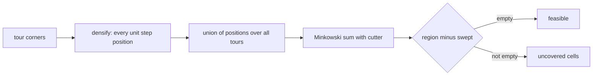

# Coverage: which cells does a tour sweep?

**Rule (from `cgshop2027_pyutils/verify.py`, confirmed by `tests/solver/test_coverage.py`):**

> swept cells = (every lattice point the cutter's center visits on any tour) ⊕ (cutter cells relative to its center)

`⊕` is the Minkowski sum: stamp the cutter at every visited point and take the union.

Details that follow from it:

- **Integer points only.** Sliding the center from `p` to `p + e` (one unit step) sweeps exactly
  the union of the two stamps, nothing in between, because the cutter is made of whole unit cells.
  So a tour is equivalent to the list of its unit-step positions.
- **Closed tours.** The way back from the last corner to the first counts too.
- **Revisits are free for coverage** (but still cost length).
- **Leaving the region is fine.** Stamps outside the region are simply ignored.
- **A one-point tour** still stamps where it stands.

The solver's `Problem.swept` / `Problem.uncovered` implement exactly this. The cross-check test
compares our uncovered-cell **count** with the official one on every shipped solution and on 200
random tours; any mismatch would be a bug on our side.
