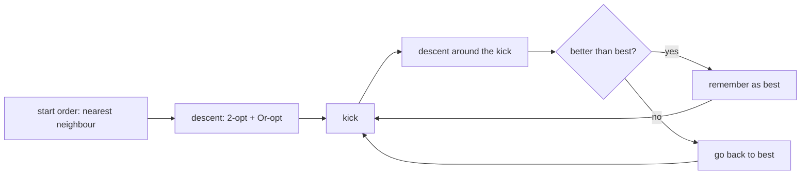

# Ordering lane segments: where the length goes

Once lanes are cut into segments, the mowing part is nearly fixed: it sits close to `cells / lane height`.
What remains is the **links**, the drives from one segment's end to the next one's start. Measured on six
challenge instances, links were **14% to 44%** of the whole walk. That is the main lever.

```
segments:   ====      =======       ===
                \    /       \     /
links:           ----         -----        <- pure overhead, minimize this
```

## Moves

**2-opt** reverses a block. Every segment in it is now driven the other way, so its entry and exit swap.
Only the two links at the block ends change:

```
before:  ... a ] [ b1 b2 b3 ] [ c ...
after:   ... a ] [ b3 b2 b1 ] [ c ...        links a->b1 and b3->c become a->b3 and b1->c
```

**Or-opt** moves one segment between two others, driven whichever way is shorter.

**Neighbour lists** keep it fast: a move only considers the 8 segments whose ends are nearest in space.

## Iterated local search

Descent stops at a *local optimum*. So we **kick** (a random block reversal, or a *double bridge* that swaps two
neighbouring blocks), descend again, and keep the result only if it beats the best so far.



| instance | segments | nearest neighbour + 2-opt | + ILS 10 s | change |
|---|---|---|---|---|
| fht47608_34k_2p4 | 50 | 875 | 805 | -8.0% |
| smo3467_11k_1x5 | 102 | 1288 | 1108 | -14.0% |
| srpg5461_22k_1l3 | 728 | 6191 | 4571 | -26.2% |
| map_frog_48k_1x9 | 112 | 2737 | 2343 | -14.4% |
| octa383_102k_2d6 | 84 | 2676 | 2324 | -13.2% |

(link length only.) OR-Tools' routing solver with guided local search did better than plain descent on small
instances but worse than this ILS on 728 segments, because its distance callback runs in Python.

**k = 1 detail:** a single cutter's walk becomes a closed tour, so its order is optimized as a cycle, including the drive home.

## Simulated annealing variant

With `anneal > 0`, a worse order after a kick is kept with probability `exp(-worse / T)`. `T` starts at
`anneal` times the order length and shrinks by 0.995 per kick. Link length after 10 s (noisy, measured
while the miner used 15 cores):

| instance | ILS | anneal 0.2% | anneal 0.5% | anneal 2% |
|---|---|---|---|---|
| fht47608_34k_2p4 | 793 | **733** | **733** | **733** |
| smo3467_11k_1x5 | 1108 | **1094** | 1098 | 1106 |
| srpg5461_22k_1l3 | 4753 | **4575** | 4583 | 4623 |
| map_frog_48k_1x9 | 2353 | 2351 | **2343** | 2421 |
| octa383_102k_2d6 | **2296** | 2308 | **2296** | **2296** |

2% is too hot. The miner runs 0.3% as round 6 alongside plain ILS seeds and keeps whichever wins.
