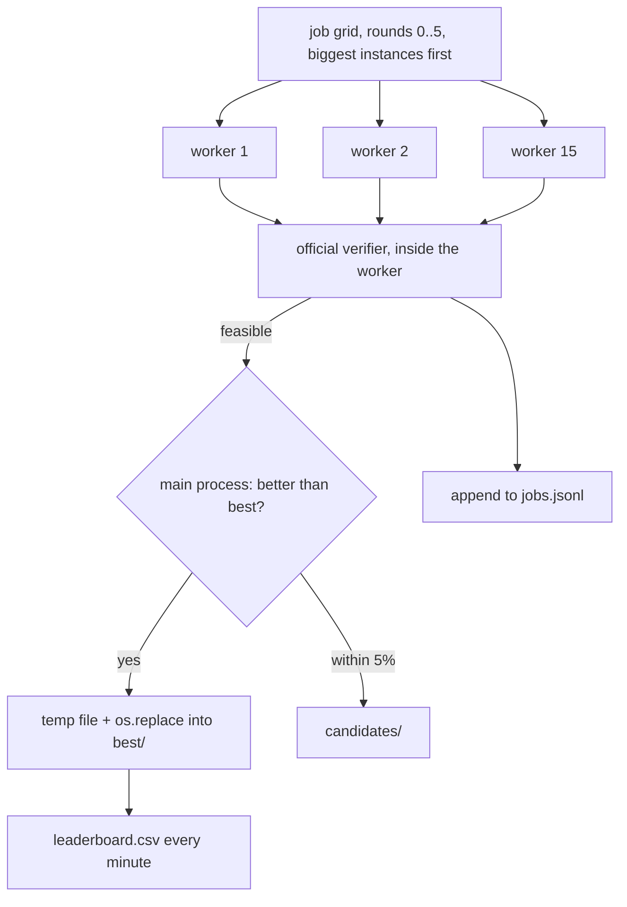

# Parallel mining

No single config wins everywhere: horizontal lanes beat vertical ones on some shapes, partitioning wins on
others, a different lane shift or ILS seed can find a shorter tour. So we run **many independent jobs**, one
per `(instance, config, seed)`, on every core, and keep the best **verified** result per instance.

```
python -m solver.mine --hours 8 --workers 15
python -m solver.report                          # headline numbers from data/leaderboard.csv
```



## Rounds (`solver/jobs.py`)

| round | what | why |
|---|---|---|
| 0 | segments h and v | feasible solution for every instance first |
| 1 | plain lanes, cover-tsp (small), band partitions | the Phase 4 baseline |
| 2 | gap factor 0, 1, 4, 8 | split vs bridge gaps |
| 3 | lane shift 1/4, 1/2, 3/4 | where band borders fall |
| 4 | partitions x gap x shift | combinations |
| 5 | ILS seeds 1 to 3, 30 s kicks | randomness in the order search |

## Safety

- **Verified only.** Workers run the official verifier; nothing unverified reaches `best/`.
- **Atomic writes.** `best/` is written via a temp file and `os.replace`, so a crash never leaves half a file.
  Retries cover OneDrive briefly locking a file.
- **Resumable.** `jobs.jsonl` records every finished job; a restart skips them. Tested by hard-killing the
  miner mid-run: no verified result was lost.
- **Memory.** One worker on an 8.7M-cell instance reached 3.5 GB, so at most 3 jobs on instances over 3M
  cells run at once.
- **Code version.** Job ids end in `|vN`. Bumping `CODE_VERSION` reruns every config with new code.
