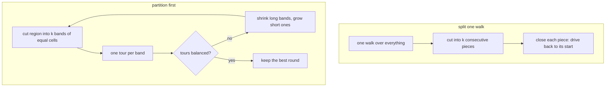

# Partitioning: giving each cutter its share

The objective is the **longest** tour, so with `k` cutters the work must be balanced.
Two ways to get there, both in the pipeline:

- **Split one walk** (`solver/split.py`): binary search on a target length `T`; greedily make each piece as
  long as `T` allows, counting the drive back to its start. This is the classic min-max k-TSP splitting idea.
- **Partition first** (`solver/partition.py`, config `partition="bands-x"` or `"bands-y"`): straight cuts so each band
  holds a share of the cells, then rebalance shares by `sqrt(mean / length)` for a few rounds.

Neither wins everywhere. On 29 challenge instances with `k > 1`, splitting a walk was slightly better on average,
but partitioning won by up to 8% on some instances, so the miner tries both and keeps the best.
