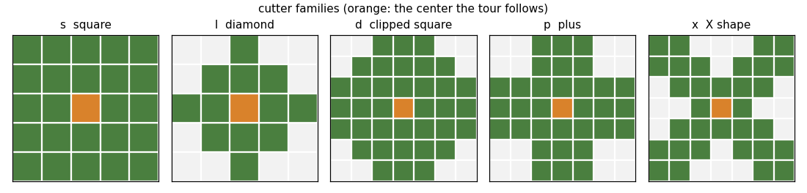
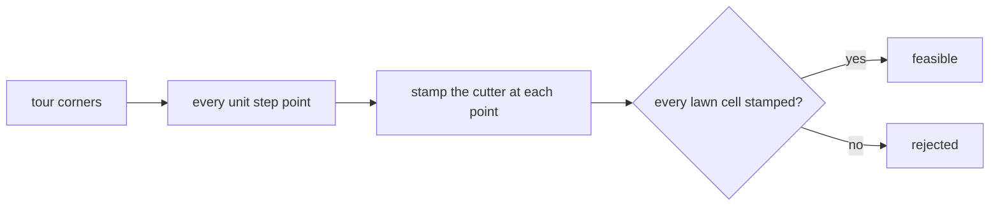
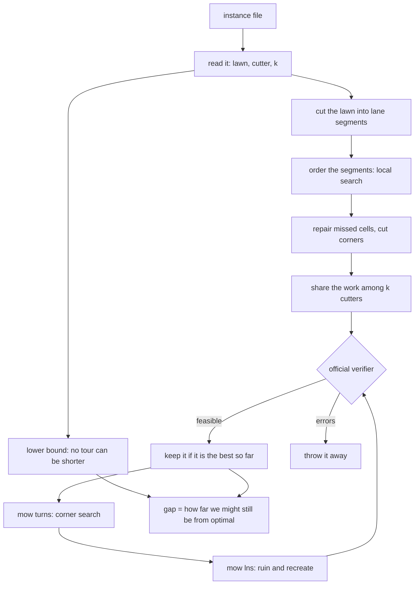
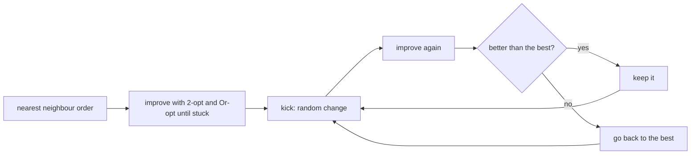
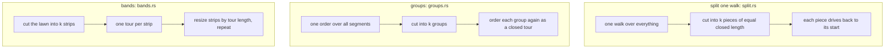
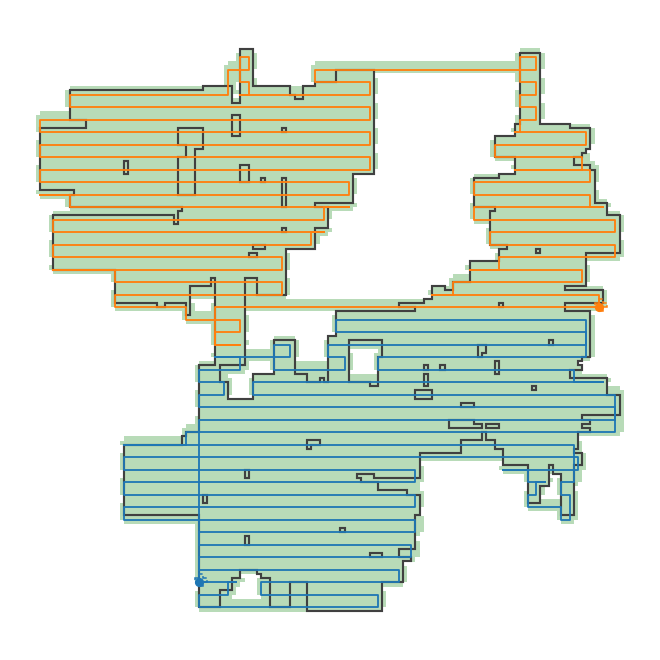
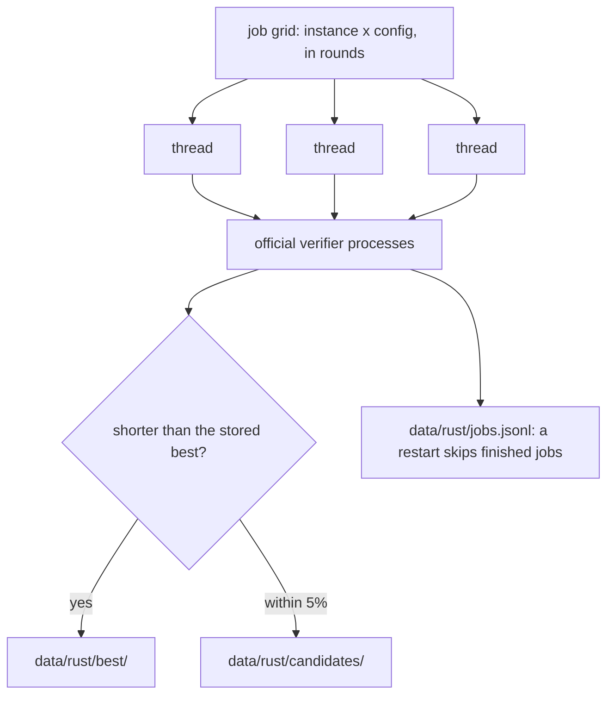
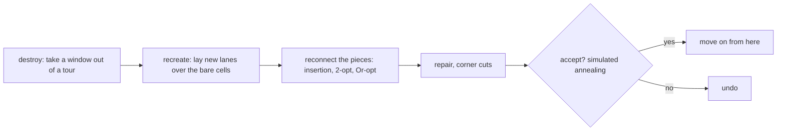
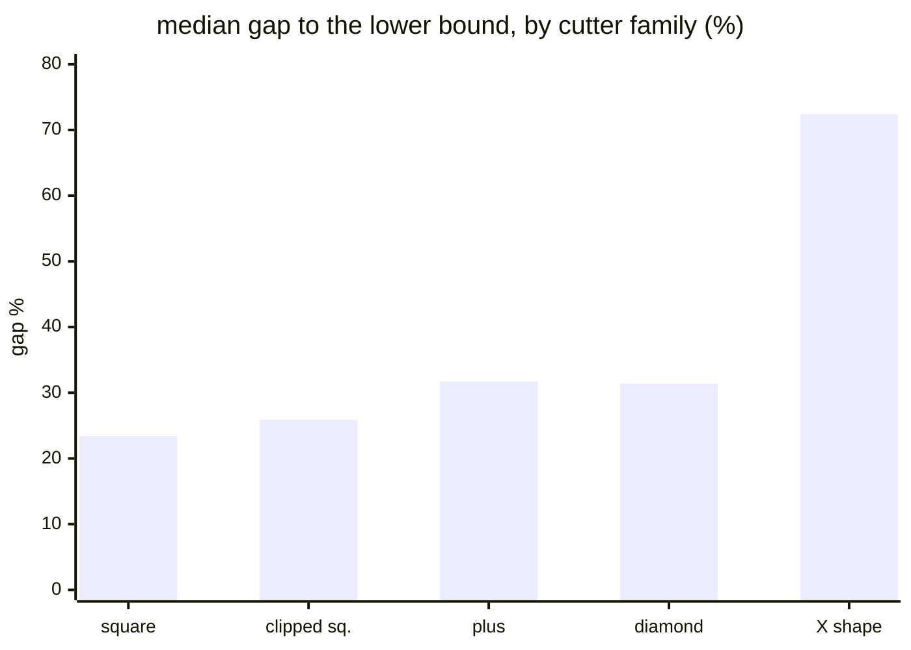
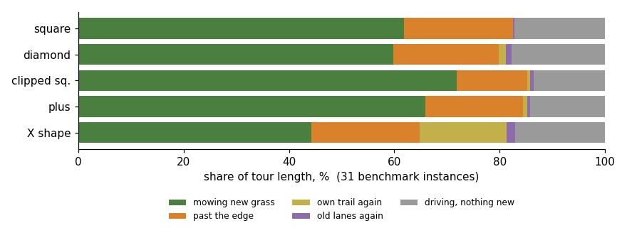

# How the solver works

A walk through the whole solver, one step at a time, with a link to the crate
that does each step. Read it top to bottom once and the code will make sense.
Commands to build, test and run everything are in the
[README's Solver section](../README.md#solver). How each piece compares with the
Python solver it was ported from is in [python-vs-rust.md](python-vs-rust.md).

## 1. The problem

We are given a lawn (a region of grid cells, often with holes), a cutter (a
small shape of cells with a center) and `k` cutters, 1 to 3. We plan one closed
tour per cutter. The tour lists the points the cutter's center drives through,
always moving straight up, down, left or right. Together the cutters must pass
over every cell of the lawn.

**The goal: make the longest tour as short as possible.** Cutters may leave the
lawn and never get in each other's way.

There are five cutter shapes, and the last letter of every instance name says
which one. `dsj1000_38k_2l3` is about 38k cells, `k = 2`, diamond cutter of
size 3.



**What counts as mowed.** Stamp the cutter at every grid point its center
visits, on every tour. The union of the stamps must cover the lawn. Points
between grid points add nothing, so a tour is just its list of unit steps. Our
own check is [`mow-coverage`](../crates/domain/coverage/src/full.rs), which
works on whole 64-bit row words. It agrees with the official verifier's count of
missed cells on all 248 instances checked.



**Scoring.** Per instance roughly `(best length of any team / our length)^2`,
summed over the 250 challenge instances. Every percent shorter counts about two
percent of an instance's points.

**Why we use heuristics.** With a 1x1 cutter and lawn cells scattered far apart,
the problem is exactly the travelling salesman problem, so no fast exact method
is known. Instances go up to 8.7 million cells. We build good tours fast,
improve them with searches on the finished tours, and measure them against a
floor (step 3).

## 2. The big picture



One run of steps 4 to 7 for one instance and one set of knobs is a **job**.
`mow mine` runs a grid of jobs on every core and keeps the best verified tour
per instance. Then two searches rework the stored bests: `mow turns` on their
corners, and `mow lns`, which takes pieces out and lays them again. Those two
searches earned most of the score. The rest of this page follows the boxes in
order.

The code is laid out as a hexagon: the domain types in the middle
(`crates/domain`), every step a plugin (`crates/plugins`), everything that
touches files or Python an adapter (`crates/adapters`), and the `mow` command on
top (`crates/app`).

## 3. Read the instance and set a floor

| file                                                                                                   | what it does                                                          |
| ------------------------------------------------------------------------------------------------------ | --------------------------------------------------------------------- |
| [`mow-io`](../crates/adapters/io/src/instance.rs)                                                      | reads instance and solution JSON                                      |
| [`problem.rs`](../crates/domain/core/src/problem.rs)                                                   | `Problem`: the lawn cells, the cutter as offsets from its center, `k` |
| [`bounds.rs`](../crates/domain/core/src/bounds.rs)                                                     | the lower bound the score is measured against                         |
| [`hull.rs`](../crates/domain/core/src/hull.rs), [`witness/`](../crates/domain/core/src/witness/mod.rs) | two tighter bounds, for diagnosis                                     |
| [`catalog.rs`](../crates/app/report/src/catalog.rs)                                                    | one row of features per instance, `mow catalog`                       |

**The lower bound** works like a paint roller. One unit step of the cutter newly
stamps at most `gain` cells (for a square of side 5 that is 5). Each cutter
starts with its own stamp of `|C|` cells. So `k` tours of length `L` cover at
most `k|C| + k L gain` cells, which must reach the lawn size:

```
L  >=  (cells - k |C|) / (k * gain)
```

For `k = 1` the tour must also reach the lawn's far edges and come back (the
**extent bound**). The lower bound is the larger of the two, rounded up to even,
since every closed walk on the grid has even length.

The **gap** is `(our length - bound) / bound`. A gap of 40% does not mean 40% is
left to win. The bound ignores driving between separate parts of the lawn, and
for the X cutter its `gain` is more than any walk achieves. Two tighter bounds
measure how much of the gap is real:

- The **hull bound** swaps the cutter for its orthogonal hull (gaps in its rows
  and columns filled in). A step gains at most `max(width, height)` cells with
  the hull, so for the X cutter the gain drops from 32 to 20: the trailing arm
  always re-mows what the leading arm just mowed. This is proved, and it shows
  the X cutters have 27.1 points of room left, not 37.1.
- The **witness bound** picks up to 256 cells far apart that each need their own
  visit and bounds the tour through them (a 1-tree for `k = 1`, a forest of `k`
  trees otherwise). It catches thin arms and long reaches. So far it has never
  beaten the hull bound.

Both are columns of `mow catalog`. The score and the gap still use the plain
bound.

## 4. Mow in lanes

The basic pattern is the one a person uses on a real lawn: back and forth in
straight lanes, one cutter height apart.

```
 lane 4  <-----------------------
                                 |
 lane 3   ----------------------->
         |
 lane 2  <-----------------------
                                 |
 lane 1   ----------------------->
```

A lane only has to run as far as its own rows of the lawn need. Where a lane
crosses a hole or a bay, we cut it into **segments** and skip the gap if a
separate trip is cheaper. All of this is the
[`mow-decompose`](../crates/plugins/decompose/src/lib.rs) crate:

| file                                                         | what it does                                                           |
| ------------------------------------------------------------ | ---------------------------------------------------------------------- |
| [`lanes.rs`](../crates/plugins/decompose/src/lanes.rs)       | plain lanes, edge to edge, gaps included (the simplest baseline)       |
| [`segments.rs`](../crates/plugins/decompose/src/segments.rs) | lanes cut into segments at gaps, knobs for gap size and lane offset    |
| [`mixed/`](../crates/plugins/decompose/src/mixed/mod.rs)     | horizontal lanes where the lawn runs wide, vertical where it runs tall |
| [`hug/`](../crates/plugins/decompose/src/hug/mod.rs)         | the lane grid shifted strip by strip, flush with the lawn's edges      |

**Mixed lanes** split the lawn into square tiles and flip each tile between
horizontal and vertical when that makes fewer, longer segments.

**Hugged lanes** fix a waste of one global lane grid: wherever the lawn's top or
bottom edge doesn't fall on a lane border, every lane there hangs over the edge.
The lawn is cut into strips of columns, and each strip picks its own lane
offset. The offsets are chosen jointly, because changing offset between two
strips costs extra lane ends.

Here is a finished single cutter tour. Each patch of the lawn gets the lane
direction that suits it, and the straight lines between patches are links.


## 5. Put the segments in a good order

Mowing a segment costs about the same whatever order we pick. The **links**
between segments are pure overhead, 14 to 44% of a walk before ordering. So the
order is the main lever, and it is a travelling salesman problem where each
segment can be driven either way.

[`mow-order`](../crates/plugins/order/src/lib.rs) uses **iterated local
search**:

- **2-opt** reverses a block of segments. Only the two links at the block ends
  change.
- **Or-opt** moves one segment between two others.
- Moves only look at the 8 nearest segment ends, found on a bucket grid, so the
  search stays fast on tens of thousands of segments.
- When no move helps, a random **kick** (a block reversal or a local double
  bridge) shakes the order up, the search descends again, and the result is kept
  only if it beats the best.



On five sample instances this cut link length by 8 to 26% over plain 2-opt. A
simulated annealing variant (`anneal` knob) sometimes accepts a worse order to
escape a dead end. Real instances have at most about 2,400 segments, so the
order settles within the time limit.

## 6. Make it feasible, then tidy it

| file                                                   | what it does                                                                     |
| ------------------------------------------------------ | -------------------------------------------------------------------------------- |
| [`repair.rs`](../crates/plugins/improve/src/repair.rs) | any cell a walk missed gets a short out-and-back detour                          |
| [`cut.rs`](../crates/plugins/improve/src/cut.rs)       | **corner cut**: replace `a -> b -> c` by a shorter way if every cell stays mowed |
| [`visits.rs`](../crates/domain/coverage/src/visits.rs) | visit counts that make the "still mowed?" check local                            |

Corner cutting can only shorten a tour. The coverage check keeps a count of how
often each grid point is visited and how many visited points sweep each cell. So
a move only rechecks the cells around the points it gives up. That check runs
about 78,000 times a second. It is what makes the searches of step 10 possible.

## 7. Share the work among k cutters

The score only counts the **longest** tour, so with 2 or 3 cutters the work must
be balanced. [`mow-assign`](../crates/plugins/assign/src/lib.rs) has three ways
to do it:



- [`split.rs`](../crates/plugins/assign/src/split.rs) cuts one walk with a
  binary search on the target length. Its weakness: each piece must drive back
  to its start, a trip the ordering never saw, 3 to 13% of every tour.
- [`groups.rs`](../crates/plugins/assign/src/groups.rs) fixes that by
  re-ordering each group as a closed tour, so the return trip becomes ordinary
  links the search shortens.
  [`rebalance.rs`](../crates/plugins/assign/src/rebalance.rs) then moves single
  segments out of the longest group. It is the method that wins most often for
  `k > 1`.
- [`bands.rs`](../crates/plugins/assign/src/bands.rs) gives each cutter its own
  strip. It rarely wins, because straight strips cut through the lawn in bad
  places.

A `k = 2` solution, one color per cutter:



## 8. Verify, always

Every tour that is stored goes through the official verifier
(`cgshop2027_pyutils.verify`).
[`mow-verify`](../crates/adapters/verify/src/lib.rs) keeps a few long-lived
Python processes running [`tools/verify/verify.py`](../tools/verify/verify.py)
and sends them one solution per line. Our own coverage check is only a fast
pre-check. Nothing unverified ever reaches the best folder.
[`mow-pipeline`](../crates/app/pipeline/src/solve.rs) ties steps 4 to 8 together
for one config (`mow solve`).

## 9. Mine: many jobs on every core

No config wins everywhere, so the miner tries many and keeps the best per
instance.



| file                                                        | what it does                                                 |
| ----------------------------------------------------------- | ------------------------------------------------------------ |
| [`grid.rs`](../crates/app/cli/src/grid.rs)                  | the job grid, in rounds, each round a new idea or knob sweep |
| [`mine/`](../crates/app/cli/src/mine/mod.rs)                | runs the jobs on threads that share one problem per instance |
| [`dir_store.rs`](../crates/adapters/store/src/dir_store.rs) | writes bests and candidates atomically, logs every job       |

`mow mine` runs rounds 0, 1, 2, 8 and 10 by default:

| round | what it tries                                     | kept because                    |
| ----- | ------------------------------------------------- | ------------------------------- |
| 0     | lane segments, both directions                    | any first tour beats no tour    |
| 1     | plain lanes, and bands for `k > 1`                | 0.07 points per CPU h           |
| 2     | gap sizes: how wide a gap a segment drives across | 0.10 points per CPU h           |
| 8     | groups (`k > 1`)                                  | 0.07, the last big win          |
| 10    | hugged lanes on the base config                   | 5 of 31 bench instances shorter |

Rounds 3 to 7 and 9 (shifts, cross products, seeds, annealing, mixed lanes, more
group variants) paid under 0.03 points per CPU hour. `--rounds` still runs them.

## 10. Search the finished tours

Mining builds tours from scratch. Three searches improve the stored best
instead. Each keeps a change only if every cell stays mowed, which the visit
counts of step 6 answer locally.

**`mow turns`** ([`mow-turns`](../crates/plugins/turns/src/lib.rs)) is a local
search on the corners of the longest tour:

- **slide** pulls a U turn at a lane end inward;
- **shortcut** replaces the way over a few corners by an L or a Z, which drops
  detours and lanes another lane already mows;
- **2-opt** drives a run of corners the other way;
- **or-opt** moves a block of 1 to 3 corners elsewhere.

For `k > 1`, once the longest tour is stuck, it shortens the others and moves
blocks to them.

**`mow lns`** ([`mow-lns`](../crates/plugins/lns/src/lib.rs)) is ruin and
recreate, after Ropke and Pisinger (2006). One move:



- **Destroy** ([`destroy.rs`](../crates/plugins/lns/src/destroy.rs)): a square
  of 2, 3 or 5 cutter widths, a band of a few lanes either way, a square around
  a stop whose stamp mows no cell that other stops miss, or (`k > 1`) a square
  of the longest tour handed to the nearest other tour.
- **Recreate** ([`recreate.rs`](../crates/plugins/lns/src/recreate.rs)): lane
  segments of step 4 over just the bare cells, either direction, at a random
  offset, or single stops for each missed cell. A missed cell's stop is the one,
  of the nearest and 32 spread over the cutter, that sweeps the most cells still
  missed: with a large cutter the nearest alone mowed mostly swept ground.
- **Accept** by the longest tour plus a tenth of the others, with a temperature
  that starts at 0.0003 of the objective and falls a hundredfold over the run.
- **Operator weights** ([`weights.rs`](../crates/plugins/lns/src/weights.rs)):
  each destroy and recreate is drawn by a weight that grows when it finds better
  tours. Weights and the tour the walk stands on are saved per instance in
  `data/rust/state/`, so the next pass (`--pass N`) continues where the last
  stopped.

**`mow polish`** ([`mow-polish`](../crates/plugins/polish/src/lib.rs)) cuts the
longest tour into 20 x 20 windows and re-solves each one exactly with Google's
CP-SAT solver, keeping the tour outside fixed. Rust builds the model and a
Python process ([`tools/cpsat/cpsat.py`](../tools/cpsat/cpsat.py)) solves it. It
was the main improvement step in Python. Next to `lns` it pays about 300 times
less per CPU hour, so `--all` now skips instances above 400k cells.

What each step paid on all 250 instances (13 and 14 November 2026; pass 3 ran
the faster binary of 14 November, see [PROGRESS.md](../PROGRESS.md)):

| step                                   | CPU h | points | points per CPU h |
| -------------------------------------- | ----- | ------ | ---------------- |
| `mow turns --all --seconds 30`         | 0.95  | +0.42  | 0.44             |
| `mow lns --all --seconds 60`           | 4.17  | +9.53  | 2.28             |
| `mow lns --all --pass 2 --seconds 300` | 20.84 | +3.24  | 0.16             |
| `mow polish --all`                     | 59.9  | +0.39  | 0.007            |
| `mow lns --all --pass 3 --seconds 300` | 21.4  | +2.61  | 0.12             |

Each further pass on the same tour pays less. A restart from a different mined
tour (the other lane direction's best candidate) beat more time on the best for
`k = 1` and 2 in a tournament on 15 instances, see
[PROGRESS.md](../PROGRESS.md).

## 11. Where we stand

Pessimistic score 136.34 of 250, every best shorter than Python's. That is the
score if some team reached every lower bound, so the real score is higher. The
median gap is 32.3% (k = 1 31.6%, k = 2 31.1%, k = 3 34.2%).



Most of the X cutters' gap is the bound, not the tours: against the hull bound
of step 3 they have no more room than the other shapes.

Where the length of the benchmark tours went before `turns` and `lns`, from
[`mow diagnose`](../crates/app/report/src/diagnose/mod.rs):



- **Past the edge** (orange): at lane ends and ragged borders the cutter's stamp
  hangs over the lawn. This is the biggest loss for every family, and what
  hugged lanes and the slide move go after.
- **Driving, nothing new** (grey): links between lanes and turns.
- **Own trail again** (yellow): only the X cutter. Its arms pass over cells its
  other arms just mowed, which the hull bound now accounts for.
- Long trips across the lawn are only 0.1 to 2.5%, so splitting the lawn better
  among cutters has little left to win.

`mow window-map` shows the same waste window by window, and how much a perfect
window re-solve could save at most.

## 12. Tools around the solver

| command                                        | what it does                                                     |
| ---------------------------------------------- | ---------------------------------------------------------------- |
| `mow bench run \| pick \| score`               | a fixed set of 31 instances, to judge an idea in minutes         |
| `mow report`                                   | the leaderboard and headline numbers                             |
| `mow mine-report`                              | which rounds and configs paid off                                |
| `mow diagnose`                                 | where the tour length goes                                       |
| `mow window-map`                               | room to save, window by window                                   |
| `mow catalog`                                  | instance features and all three bounds                           |
| `mow compare`                                  | every best against Python's, re-checked by the official verifier |
| [`mow-viz`](../crates/adapters/viz/src/lib.rs) | SVG pictures of stored solutions                                 |

## 13. Tried and dropped

- **Cover then TSP** (visit a set of stamp points in TSP order): never won a
  single instance in mining.
- **Lanes cut into cells**: failed its benchmark gate.
- **Narrow lanes** (lanes closer than the cutter height): made tours longer.
- **Diagonal lanes**: dropped without building, because the hull bound proves no
  walk sweeps faster than straight lanes.
- **Joining lanes across gaps**: joining only takes freedom away from the order.
- **Spirals**: ring corners pay the same dead steps as lane ends.
- **Split first** (cut the lawn into `k` parts, then tour each): beat the group
  constructions head to head but improved only 5 of 21 bests that had already
  been searched.
- **A hotter lns walk** (temperature 0.003): worse than the default and stuck on
  5 of 15 instances.

## Words used in the code

| word              | meaning                                                                 |
| ----------------- | ----------------------------------------------------------------------- |
| anchor, position  | a grid point where the cutter's center stands                           |
| footprint, stamp  | the cells under the cutter at one anchor                                |
| walk, route       | an open route; a **tour** is a closed one                               |
| corners           | the points where a route turns, what the solution file stores           |
| lane, segment     | a straight sweep; a segment is the part of a lane that has cells to mow |
| link              | the drive from one segment's end to the next one's start                |
| config            | one set of knobs: method, parameters, partition, seed                   |
| job               | one config run on one instance, with a time limit                       |
| round             | a batch of jobs that tries one idea on every instance                   |
| best, candidate   | the shortest verified tour so far; others within 5% of it               |
| pass, state       | one `lns` run over the instances; what it leaves for the next pass      |
| destroy, recreate | the two halves of an `lns` move, each a set of weighted operators       |
| gap               | `(ours - bound) / bound`                                                |
| pessimistic score | `sum (bound / ours)^2`, our score if another team reached every bound   |
