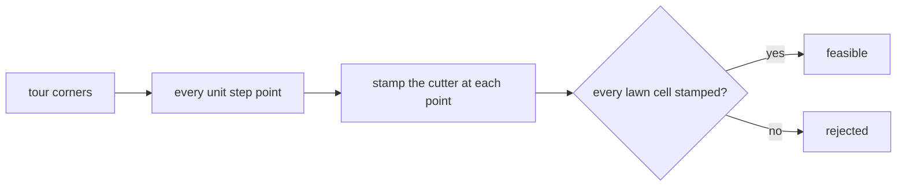
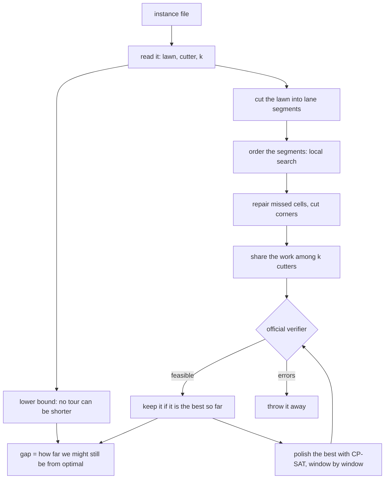
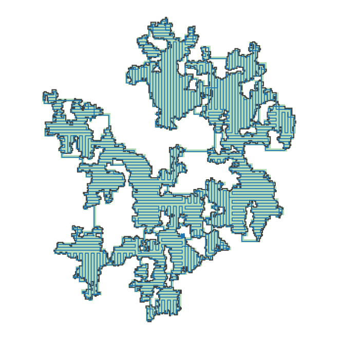
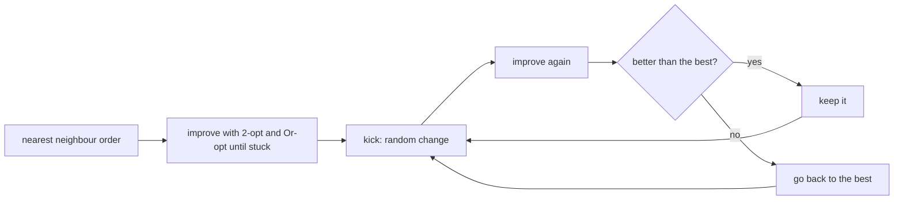
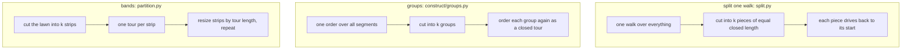
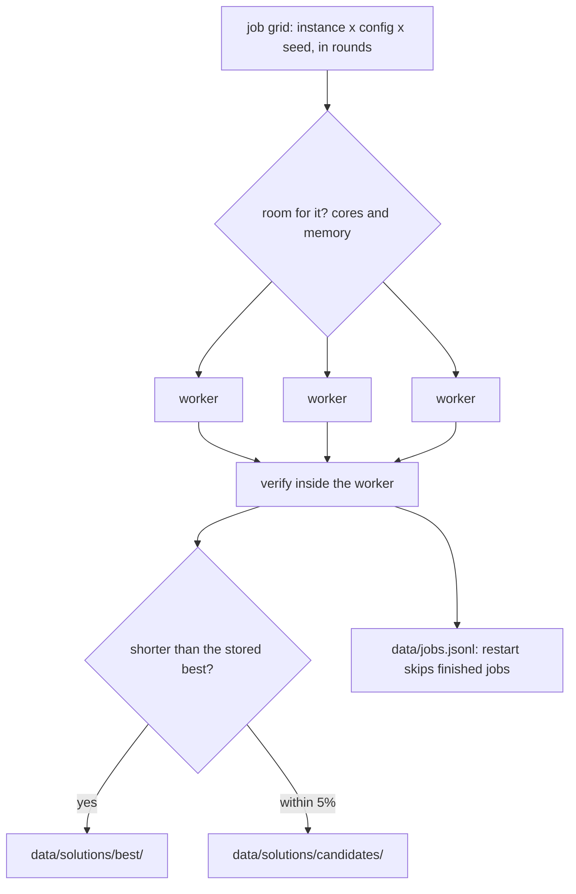
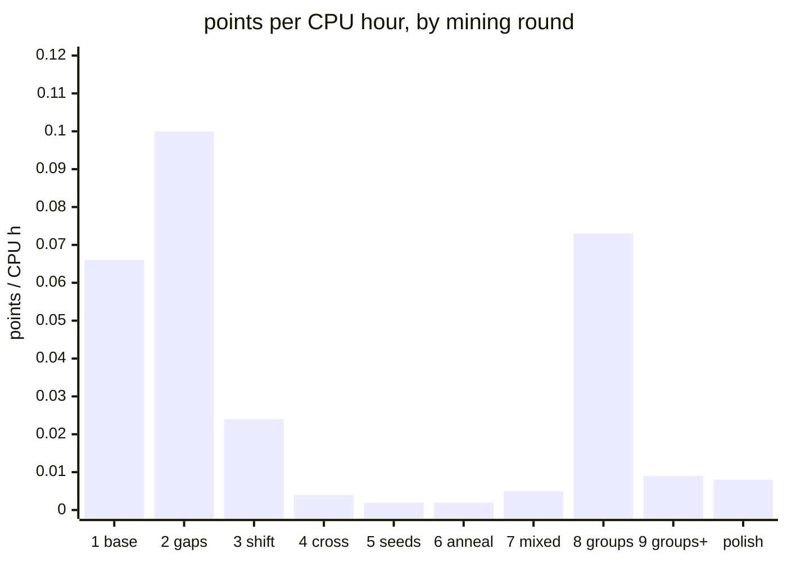
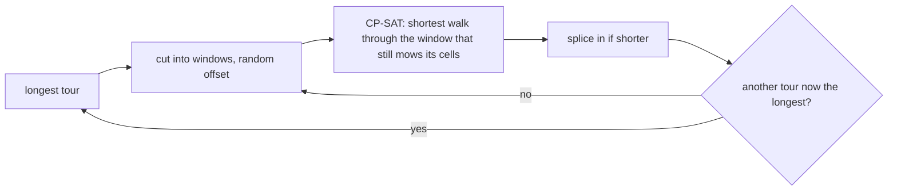
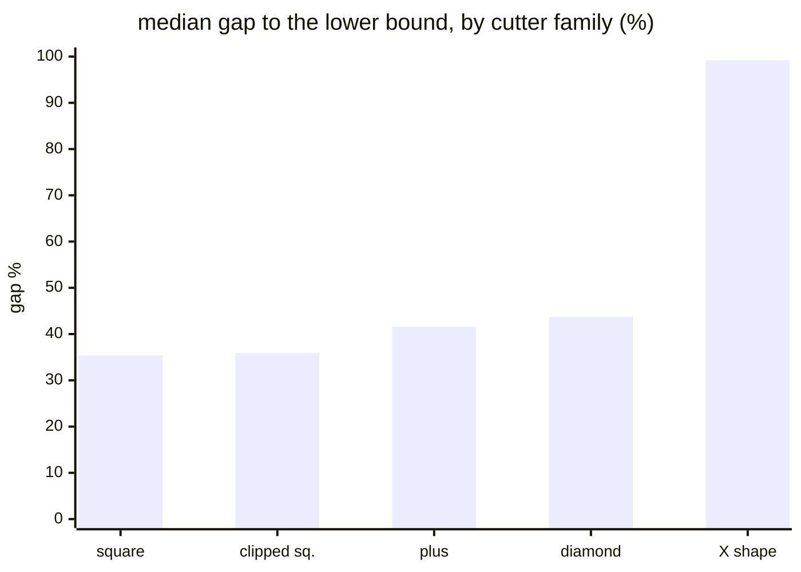

# How the solver works

A walk through the whole solver, one step at a time, with a link to the file
that does each step. Read it top to bottom once and the code will make sense.
Commands to set up, test and run everything are in
[`solver/README.md`](../solver/README.md).

## 1. The problem

We are given a lawn (a region of grid cells, often with holes), a cutter (a
small shape of cells with a center) and `k` cutters, 1 to 3. We plan one closed
tour per cutter. The tour lists the points the cutter's center drives through,
always moving straight up, down, left or right. Together the cutters must pass
over every cell of the lawn.

**The goal: make the longest tour as short as possible.** Cutters may leave the
lawn and never get in each other's way.

There are five cutter shapes, and the last letter of every instance name says
which one. `dsj1000_38k_2l3` is about 38k cells, `k = 2`, diamond cutter of
size 3.


**What counts as mowed.** Stamp the cutter at every grid point its center
visits, on every tour. The union of the stamps must cover the lawn. Points
between grid points add nothing, so a tour is just its list of unit steps. Our
own check is [`Problem.swept`](../solver/model.py), and a test compares it with
the official verifier on hundreds of tours.



**Scoring.** Per instance roughly `(best length of any team / our length)^2`,
summed over the 250 challenge instances. Every percent shorter counts about two
percent of an instance's points.

**Why we use heuristics.** With a 1x1 cutter and lawn cells scattered far apart,
the problem is exactly the travelling salesman problem, so no fast exact method
is known. Instances go up to 8.7 million cells. We build good tours fast,
improve them, and measure them against a floor (step 3).

## 2. The big picture



One run of that pipeline for one instance and one set of knobs is a **job**. The
**miner** runs thousands of jobs, on every core, with different knobs, and keeps
the best verified tour per instance. The rest of this page follows the boxes in
order.

## 3. Read the instance and set a floor

| file                                 | what it does                                                          |
| ------------------------------------ | --------------------------------------------------------------------- |
| [`model.py`](../solver/model.py)     | `Problem`: the lawn cells, the cutter as offsets from its center, `k` |
| [`tours.py`](../solver/tours.py)     | converts between corner lists, unit step points and solution objects  |
| [`catalog.py`](../solver/catalog.py) | one row of features per instance into `data/catalog.csv`              |
| [`bounds.py`](../solver/bounds.py)   | the lower bound                                                       |

**The lower bound** works like a paint roller. One unit step of the cutter newly
stamps at most `gain` cells (for a square of side 5 that is 5). Each cutter
starts with its own stamp of `|C|` cells. So `k` tours of length `L` cover at
most `k|C| + k L gain` cells, which must reach the lawn size:

```
L  >=  (cells - k |C|) / (k * gain)
```

The **gap** is `(our length - bound) / bound`. A gap of 40% does not mean 40% is
left to win: the bound ignores driving between separate parts of the lawn, and
for the X cutter its `gain` is more than any straight drive achieves.

## 4. Mow in lanes

The basic pattern is the one a person uses on a real lawn: back and forth in
straight lanes, one cutter height apart.

```
 lane 4  <-----------------------
                                 |
 lane 3   ----------------------->
         |
 lane 2  <-----------------------
                                 |
 lane 1   ----------------------->
```

A lane only has to run as far as its own rows of the lawn need. Where a lane
crosses a hole or a bay, we cut it into **segments** and skip the gap if a
separate trip is cheaper.

| file                                                       | what it does                                                           |
| ---------------------------------------------------------- | ---------------------------------------------------------------------- |
| [`construct/lanes.py`](../solver/construct/lanes.py)       | plain lanes, edge to edge, gaps included (the simplest baseline)       |
| [`construct/segments.py`](../solver/construct/segments.py) | lanes cut into segments at gaps, knobs for gap size and lane offset    |
| [`construct/mixed.py`](../solver/construct/mixed.py)       | horizontal lanes where the lawn runs wide, vertical where it runs tall |

`mixed.py` splits the lawn into square tiles and flips each tile between
horizontal and vertical when that makes fewer, longer segments. It won 11 of the
31 benchmark instances when it was added.

Here is a finished single cutter tour. Each patch of the lawn gets the lane
direction that suits it, and the straight lines between patches are links.



## 5. Put the segments in a good order

Mowing a segment costs about the same whatever order we pick. The **links**
between segments are pure overhead, 14 to 44% of a walk before ordering. So the
order is the main lever, and it is a travelling salesman problem where each
segment can be driven either way.

[`construct/ordering.py`](../solver/construct/ordering.py) uses **iterated local
search**:

- **2-opt** reverses a block of segments. Only the two links at the block ends
  change.
- **Or-opt** moves one segment between two others.
- Moves only look at the 8 nearest segment ends, so the search stays fast on
  tens of thousands of segments.
- When no move helps, a random **kick** shakes the order up, the search descends
  again, and the result is kept only if it beats the best.



On five sample instances this cut link length by 8 to 26% over plain 2-opt. A
simulated annealing variant (`anneal` knob) sometimes accepts a worse order to
escape a dead end.

## 6. Make it feasible, then tidy it

| file                                 | what it does                                                                     |
| ------------------------------------ | -------------------------------------------------------------------------------- |
| [`repair.py`](../solver/repair.py)   | any cell a walk missed gets a short out-and-back detour                          |
| [`improve.py`](../solver/improve.py) | **corner cut**: replace `a -> b -> c` by a shorter way if every cell stays mowed |

Corner cutting can only shorten a tour. To check coverage quickly it keeps a
count of how often each grid point is visited, so a move only rechecks the cells
around the points it gives up.

## 7. Share the work among k cutters

The score only counts the **longest** tour, so with 2 or 3 cutters the work must
be balanced. We have three ways to do it:



- [`split.py`](../solver/split.py) cuts one walk with a binary search on the
  target length. Its weakness: each piece must drive back to its start, a trip
  the ordering never saw, 3 to 13% of every tour.
- [`construct/groups.py`](../solver/construct/groups.py) fixes that by
  re-ordering each group as a closed tour, so the return trip becomes ordinary
  links the search shortens. It is the method that wins most often for `k > 1`.
- [`partition.py`](../solver/partition.py) gives each cutter its own strip. It
  rarely wins, because straight strips cut through the lawn in bad places.

A `k = 2` solution, one color per cutter:


## 8. Verify, always

Every tour that leaves a job goes through the official verifier
(`cgshop2027_pyutils.verify`). Nothing unverified ever reaches the best store.
[`pipeline.py`](../solver/pipeline.py) ties steps 4 to 8 together for one
config.

## 9. Mine: many jobs on every core

No config wins everywhere, so the miner tries many and keeps the best per
instance.



| file                                     | what it does                                                 |
| ---------------------------------------- | ------------------------------------------------------------ |
| [`jobs.py`](../solver/jobs.py)           | the job grid, in rounds, each round a new idea or knob sweep |
| [`mine.py`](../solver/mine.py)           | runs the jobs, writes bests safely, resumes after a crash    |
| [`resources.py`](../solver/resources.py) | starts a job only when enough cores and memory are free      |

What each round paid, in points of pessimistic score per CPU hour. Round 8
(groups) was the last big win, and the seed, annealing and cross-product rounds
bought almost nothing.



Round 0 is left out of the chart: it paid 0.71, since any first tour beats no
tour.

## 10. Polish the best tours

Mining builds tours from scratch. [`polish.py`](../solver/polish.py) improves
the stored best instead. It cuts the longest tour into 20 x 20 windows and
re-solves each window exactly with Google's CP-SAT solver
([`window.py`](../solver/window.py)), keeping the tour outside fixed. Any
shorter way through a window is spliced in.



One polish pass over every instance improved 198 of 250 bests. Most stored bests
are now polished.

## 11. Where we stand

Pessimistic score 113.1 of 250. That is the score if some team reached every
lower bound, so the real score is higher. The median gap is 45.9%.



Where the length of the benchmark tours goes, from
[`diagnose.py`](../solver/diagnose.py):


- **Past the edge** (orange): at lane ends and ragged borders the cutter's stamp
  hangs over the lawn. This is the biggest loss for every family.
- **Driving, nothing new** (grey): links between lanes and turns.
- **Own trail again** (yellow): only the X cutter. Its arms pass over cells its
  other arms just mowed, which the lower bound does not account for. Much of the
  X gap is a loose bound, not a bad tour.
- Long trips across the lawn are only 0.1 to 2.5%, so splitting the lawn better
  among cutters has little left to win.

[`window_map.py`](../solver/window_map.py) shows the same waste window by
window, and how much a perfect window re-solve could save at most.

## 12. Tools around the solver

| file                                         | what it does                                             |
| -------------------------------------------- | -------------------------------------------------------- |
| [`bench.py`](../solver/bench.py)             | a fixed set of 31 instances, to judge an idea in minutes |
| [`report.py`](../solver/report.py)           | the leaderboard and headline numbers                     |
| [`mine_report.py`](../solver/mine_report.py) | which rounds and configs paid off                        |
| [`diagnose.py`](../solver/diagnose.py)       | where the tour length goes                               |
| [`plot.py`](../solver/plot.py)               | pictures of stored solutions                             |
| [`plot_app.py`](../solver/plot_app.py)       | a window to browse and draw solutions                    |

## 13. Tried and dropped

- **Cover then TSP** (visit a set of stamp points in TSP order): never won a
  single instance in mining.
- **Lanes cut into cells**: failed its benchmark gate.
- **Narrow lanes** (lanes closer than the cutter height): made tours longer.
- **Patch first** (split the lawn into one patch per cutter, then route each):
  the bands in `partition.py` are this idea with straight cuts, and they almost
  never win. The cross lawn travel it saves is under 3% of a tour.

## Words used in the code

| word              | meaning                                                                 |
| ----------------- | ----------------------------------------------------------------------- |
| anchor, position  | a grid point where the cutter's center stands                           |
| footprint, stamp  | the cells under the cutter at one anchor                                |
| walk              | an open route; a **tour** is a closed one                               |
| corners           | the points where a route turns, what the solution file stores           |
| lane, segment     | a straight sweep; a segment is the part of a lane that has cells to mow |
| link              | the drive from one segment's end to the next one's start                |
| config            | one set of knobs: method, parameters, partition, seed                   |
| job               | one config run on one instance, with a time limit                       |
| round             | a batch of jobs that tries one idea on every instance                   |
| best, candidate   | the shortest verified tour so far; others within 5% of it               |
| gap               | `(ours - bound) / bound`                                                |
| pessimistic score | `sum (bound / ours)^2`, our score if another team reached every bound   |
