# How it works

This page explains, in plain words, what our solver does and why: the problem,
then every approach we tried, from the most obvious one to the searches that
earned most of our score. Each new word is explained the first time it appears,
and there is a [glossary](#glossary) at the end.

Most pictures show the **same small lawn**, so you can see exactly what each
idea changes. Every tour drawn on it is a real result of our solver, checked by
the contest's official checker. For the full story with every number, see
[timeline.md](timeline.md) and [PROGRESS.md](../PROGRESS.md).

**Contents**

1. [The problem](#1-the-problem)
2. [How we know how good a tour is](#2-how-we-know-how-good-a-tour-is)
3. [Approach 1: plain lanes](#3-approach-1-plain-lanes-the-obvious-way)
4. [Approach 2: lane segments in a good order](#4-approach-2-lane-segments-in-a-good-order)
5. [Approach 3: sharing the work between cutters](#5-approach-3-sharing-the-work-between-cutters)
6. [Approach 4: mining, try many settings and keep the best](#6-approach-4-mining-try-many-settings-and-keep-the-best)
7. [Checking every answer](#7-checking-every-answer)
8. [Measuring the waste](#8-measuring-the-waste)
9. [Ideas that did not work](#9-ideas-that-did-not-work)
10. [Rewriting it to run faster](#10-rewriting-it-to-run-faster)
11. [Approach 5: corner moves](#11-approach-5-corner-moves)
12. [Approach 6: ruin and recreate](#12-approach-6-ruin-and-recreate)
13. [Tuning the search](#13-tuning-the-search)
14. [The whole journey](#14-the-whole-journey)
15. [Where we stand, and what is next](#15-where-we-stand-and-what-is-next)
16. [Glossary](#glossary)
17. [For developers: where things are in the code](#for-developers-where-things-are-in-the-code)

---

## 1. The problem

### A lawn and a cutter

Think of a lawn drawn on graph paper. Every square of the paper that is lawn
must be mowed. Some lawns have **holes** in them, like a pond, which do not need
mowing (here in blue).

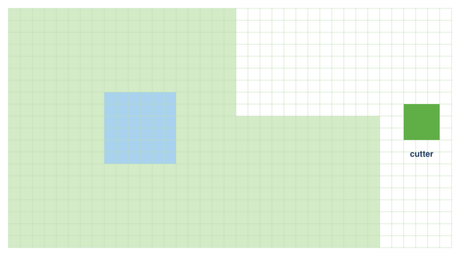

The **cutter** is the mower's blade: a small shape of squares. Here it is a 3 ×
3 square. The contest has five cutter shapes:

### Driving mows

The cutter drives over the paper one square at a time, only up, down, left or
right. Whatever is under it gets mowed. Each **step** (one move by one square)
brings at most three new squares under a 3 × 3 cutter:

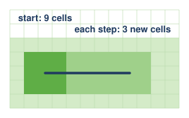

> **Stamp:** the squares under the cutter at one position. Driving is like
> pressing the stamp down again after every step.

### What we have to find

A **tour**: a route that starts somewhere, drives around, and comes back to
where it started, so that every lawn square was under the cutter at some point.
Driving off the lawn or over the pond is allowed; it just wastes steps. **The
goal is a tour with as few steps as possible.**

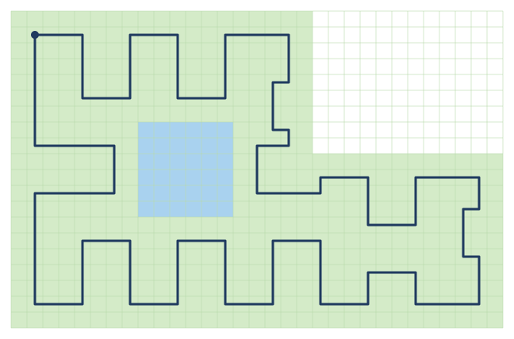

### More than one cutter

Some lawns come with 2 or 3 cutters working at the same time. Each one drives
its own tour, and together they must mow everything. The job is done when the
**last** cutter gets back, so what counts is the **longest** of the tours. The
work has to be shared fairly:

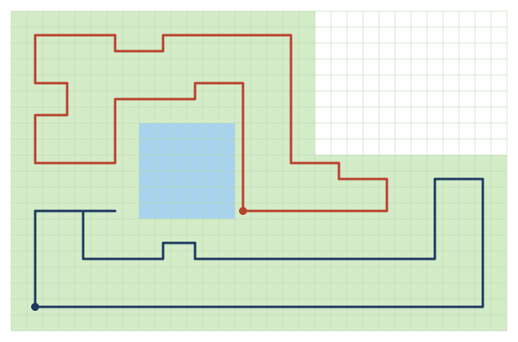

### The contest

There are 250 lawns, from a few thousand squares up to 8.7 million. For each
lawn, the score is roughly **(best length any team found ÷ our length)²**, added
up over all 250. Squaring means every 1% shorter is worth about 2% of that
lawn's points.

### Why there is no perfect method

With a 1 × 1 cutter and lawn squares scattered far apart, the problem becomes
the famous **travelling salesman problem** (TSP): visit every city once by the
shortest round trip. TSP is **NP-hard**, which in practice means no method is
known that finds the best answer quickly on large inputs. Our lawns are huge, so
we use **heuristics**: methods that find very good answers fast, without a
guarantee that they are the best.

---

## 2. How we know how good a tour is

Since we cannot know the best possible tour, we compute a **lower bound**: a
length no tour can beat. It works like a paint roller. On the toy lawn:

- the lawn has 476 squares;
- the cutter's first position mows 9 of them;
- every step after that mows at most 3 new ones;
- so any tour needs at least (476 − 9) ÷ 3 ≈ **156 steps**.

Our best toy tour has 160 steps: within 2.6% of the bound, so it cannot be
improved by more than that.

The **gap** is how far a tour is above the lower bound, in percent. A small gap
means little room is left. A large gap may mean the tour is poor, or that the
bound is too optimistic. For the X-shaped cutter, for example, the bound assumes
every step mows more new squares than the X's arms ever can. We proved a tighter
bound for such cutters, the **hull bound**, which shows the X cutters have less
room left than the plain bound suggests.

> **Pessimistic score:** our score computed as if some team had reached the
> lower bound on every lawn. The real score can only be higher. All scores on
> this page are pessimistic.

---

## 3. Approach 1: plain lanes (the obvious way)

How a person mows a real lawn: back and forth in straight rows, called
**lanes**, each one cutter-width (3 squares) apart.

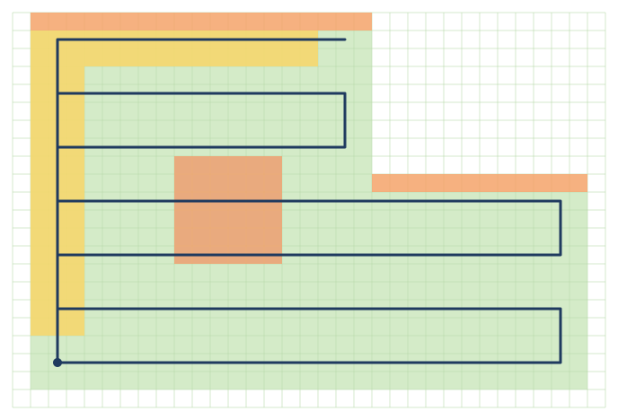

**212 steps** (the lower bound is 156). The colours show the waste:

- **orange:** squares mowed that are not lawn. The lanes drive straight over the
  pond and past the lawn's edges;
- **yellow:** lawn mowed a second time. To get back to the start, the tour
  drives down the left side over lanes it already mowed.

Plain lanes always work and are quick to compute, so they became our
**baseline**: the result every later idea is compared with.

---

## 4. Approach 2: lane segments in a good order

**Idea 1: skip what is not lawn.** Cut each lane where it leaves the lawn, into
pieces called **segments**. Mow only the segments, and decide for each gap
whether to drive through it or go around.

**Idea 2: visit the pieces in a good order.** Once the lawn is in pieces, the
order matters a lot. Here two islands of lawn are mowed with the same lanes in
two orders: crossing between the islands after every lane, or finishing one
island before going to the other:

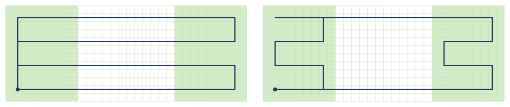

Choosing the order is itself a travelling salesman problem, with the segments as
the "cities". We solve it with **local search**: start with some order, then
keep making small changes that shorten it, until no small change helps. Two
classic small changes:

- **2-opt:** take a stretch of the order and run it backwards;
- **or-opt:** take one piece out and put it somewhere else.

When no small change helps any more, the search gets a random **kick** (a bigger
shake-up) and continues, keeping the result only if it is better. This is called
**iterated local search**.

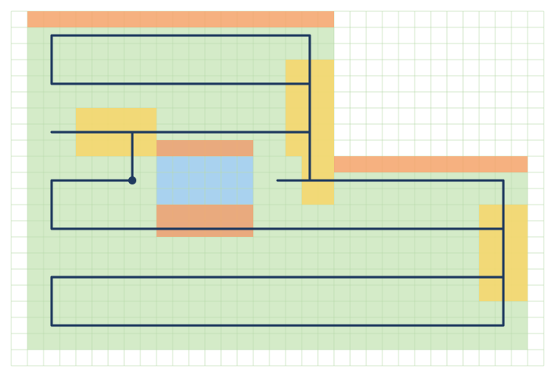

**194 steps**, down from 212. On the real lawns, segments beat plain lanes by up
to 32%.

---

## 5. Approach 3: sharing the work between cutters

With 2 or 3 cutters, the simplest idea is to build one good tour and cut it into
fair pieces, one per cutter. Each piece then drives back to its start:

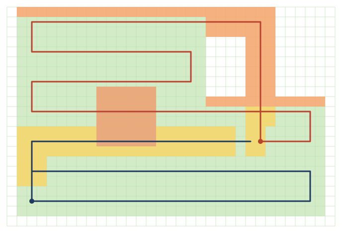

We tried three ways to share the work:

| way             | how it works                                                        | how it did                        |
| --------------- | ------------------------------------------------------------------- | --------------------------------- |
| split the tour  | one tour over everything, cut into equal pieces                     | simple; the trips back cost 3–13% |
| groups of lanes | cut the segments into groups, then order each group as its own tour | won most often                    |
| bands           | cut the lawn into strips first, one per cutter                      | rarely won                        |

**Groups** won most often because each group is planned as a closed tour from
the start, so the trip back is optimised like any other part of the tour.

---

## 6. Approach 4: mining, try many settings and keep the best

Every method above has **settings**: lanes across or up and down, how big a gap
to drive through, where the first lane starts, and so on. No setting wins on
every lawn. So we ran many settings on every lawn, on every processor core of
the computer, and kept the shortest tour for each lawn. We call this **mining**.

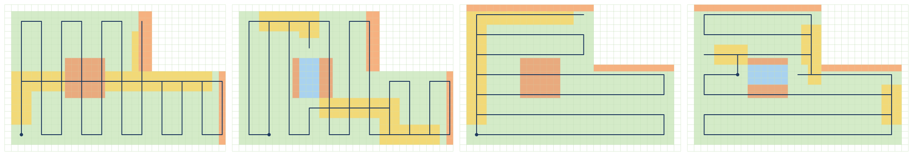

Left to right: lanes up and down (228), segments up and down (210), lanes across
(212), segments across (194). The miner keeps 194.

The first night of mining solved all 250 lawns. But each further round of
settings paid less: rounds 3 to 6 bought only 0.4 points for 64 hours of
computing. Mining was used up.

> **CPU hour:** one processor core working for one hour. Our machine has 16
> cores, so one night is about 120 CPU hours.
>
> **Points per CPU hour:** how much score a kind of run earns for the computing
> it uses. We used it to decide what to run next.

---

## 7. Checking every answer

A tour that misses even one square is worthless. Every tour we keep goes through
the contest's **official verifier**, the organisers' own checking program. Our
solver has its own, much faster coverage check for its searches, but nothing is
stored as a best until the official one agrees.

> **Valid** (or **feasible**): a tour that mows every lawn square and follows
> the rules.

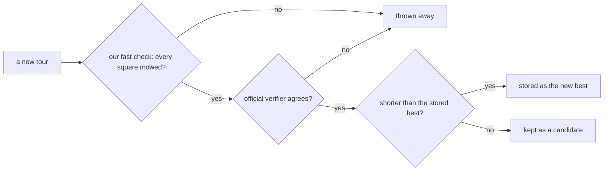

---

## 8. Measuring the waste

Before trying new ideas, we measured where the length of our tours goes. Over
the best tours of all 250 lawns:

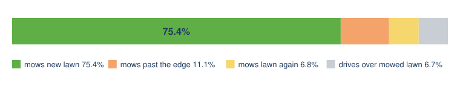

- **mows new lawn:** useful work;
- **mows past the edge:** most of it at the ends of lanes, where the cutter
  sticks out over the lawn's edge;
- **mows lawn again:** overlapping passes;
- **drives over mowed lawn:** getting from one lane to the next.

About a quarter of every tour was waste, much of it at **lane ends** and
**turns**. Building tours differently from scratch had stopped helping, so the
next step was to improve the finished tours directly. That needed speed.

---

## 9. Ideas that did not work

Every new idea first had to pass a **gate**: a test on a fixed set of 31 lawns
(the **bench**), where it had to beat our stored bests on at least a third of
them, at a fair cost in computing time. Most ideas failed, which saved us from
spending nights on them.

**Cover, then tour.** First choose cutter positions that together cover the
lawn, then visit them in TSP order. It never won a single lawn: driving from
position to position wastes the steps in between.

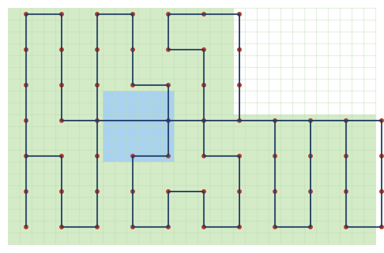

**Narrow lanes.** Lanes 2 apart instead of 3, so that lanes overlap and perhaps
fit the edges better. The overlap (yellow) costs more than it saves:

And more, in one line each:

| idea                              | why it failed                                                              |
| --------------------------------- | -------------------------------------------------------------------------- |
| an exact solver on small windows  | too slow at the scale of the waste, and the windows were already optimal   |
| cells shaped to the lawn          | splitting the lawn into regions, each with its own lanes, failed the bench |
| diagonal lanes                    | our hull bound proves no route mows faster than straight lanes             |
| spirals                           | every corner of a spiral costs the same wasted steps as a lane end         |
| joining lanes across gaps         | joining only takes choices away from the ordering                          |
| splitting the lawn before touring | good on fresh tours, but rarely beat a tour that had already been improved |
| a move aimed at the lawn's edge   | the search learned it rarely pays; a draw on the bench                     |
| lane ends chosen together         | the tours got slightly longer                                              |

---

## 10. Rewriting it to run faster

The first solver was written in **Python**, a language that is easy to write but
slow. We rewrote it in **Rust**, a language that runs about as fast as a
computer can, checking each piece against the Python version first.

| piece                   | Rust is                            |
| ----------------------- | ---------------------------------- |
| reading a lawn          | 8 × faster, 55 × less memory       |
| checking coverage       | 280 × faster                       |
| checking one small edit | from 2.25 to **78,000** per second |
| ordering the segments   | 110 to 3,300 × faster              |

The same tours now took 85 CPU hours instead of 307. The score barely moved
(113.10 to 113.57): **the rewrite bought time, not points.** What mattered was
the 78,000 edit checks per second: fast enough to try millions of small changes
on a finished tour. The next two approaches do exactly that.

See [python-vs-rust.md](python-vs-rust.md) for the full comparison.

---

## 11. Approach 5: corner moves

Take a finished tour and try small changes to its corners, keeping each change
only if the tour gets shorter **and** still mows every square. The main change
is the **slide**: pull a U-turn that sticks out past the lawn's edge back in.

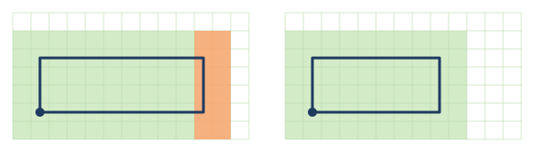

Three more moves:

- **shortcut:** replace a detour over a few corners with a straight L or Z;
- **2-opt:** drive a run of corners the other way round;
- **or-opt:** move a short run of corners to another place in the tour.

With several cutters, once the longest tour is stuck, the moves shorten the
others and hand them pieces of the longest one.

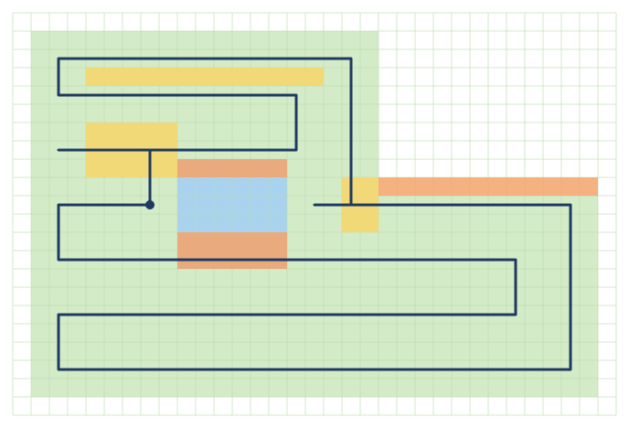

**180 steps**, down from 194. On the real lawns this paid 0.44 points per CPU
hour, 60 times what the exact window solver paid.

---

## 12. Approach 6: ruin and recreate

The idea that earned the most. Each **move** has three parts:

1. **Ruin:** pick a window of the lawn and tear the tour out of it. Some squares
   are now unmowed (red).
2. **Recreate:** lay new lanes over exactly those squares, and connect them back
   into the tour.
3. **Decide:** keep the new tour if it is shorter, and **sometimes even if it is
   slightly longer**.

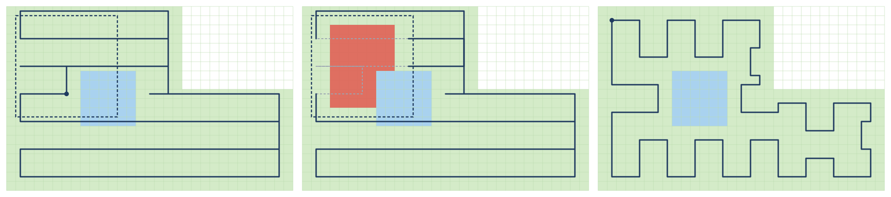

The right panel is the tour after many thousands of such moves: **160 steps**,
down from 180, against a lower bound of 156.

### Why accept a longer tour?

Picture every possible tour as a point in a hilly landscape, where height is the
tour's length. A search that only ever goes downhill stops in the first dip it
finds. Allowing small climbs lets it cross a hill into a deeper valley:

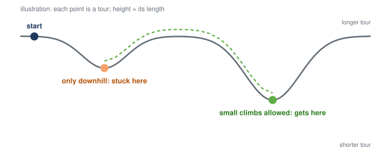

This is **simulated annealing**, named after cooling metal slowly. A
**temperature** says how big a climb is still accepted. It starts warm (bigger
climbs allowed) and cools down over the run (only small ones), so the search
explores first and settles at the end.

### Learning which moves work

There are several ways to ruin (a small square, a big square, a band of lanes,
the area around a wasteful spot) and several ways to recreate (lanes across,
lanes up and down, single positions). Each way gets a **weight**, and the ones
that find better tours more often get picked more often. This is **adaptive
large neighbourhood search** (ALNS), after Ropke and Pisinger (2006).

> **Neighbourhood:** all the tours one move away from the current one. A "large"
> neighbourhood means each move can change a lot at once.

### With several cutters

A move can also take a stretch of lawn from the longest tour and give it to
another cutter:

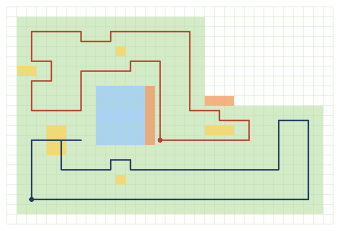

**84 steps**, down from 112, against a lower bound of 78.

**On the real lawns:** its first 60-second pass over all 250 lawns added **9.5
points**, 300 times what the exact window solver paid per CPU hour. That night,
with the corner moves and a longer second pass, the score went from 113.6 to
132.3.

---

## 13. Tuning the search

Each change below was tested as an **A/B test**: two versions run side by side
on the same lawns with the same computing time, and only the winner kept.

**Faster moves.** Profiling (measuring where the time goes) showed where a move
spent its time. Choosing better positions to repair from made moves 2.6 ×
faster, and the next pass found 187 new bests. Then stamping a whole straight
run of positions at once, instead of square by square, made moves up to 5 ×
faster again on large cutters.

**Restarts.** Starting the search again from a different first tour (the other
lane direction) beat spending more time on the best tour on 92 of 149 lawns with
1 or 2 cutters.

**Time where it pays.** Giving lawns that are still improving more time than
those that are stuck.

**A bug: the search wandered off.** On long tours, the search drifted far from
its best tour, up to 48% longer, and never came back. The temperature was set as
a share of the **whole** tour, so on a long tour it allowed huge climbs, while
one move only changes a few cutter-widths of tour. Capping the temperature at a
fraction of one cutter width fixed it:

| version         | points gained on 39 long lawns, same time |
| --------------- | ----------------------------------------- |
| without the cap | +0.01                                     |
| with the cap    | **+0.58**                                 |

Lawns that no run had improved in days got up to 6.8% shorter.

---

## 14. The whole journey

The same lawn, approach by approach:

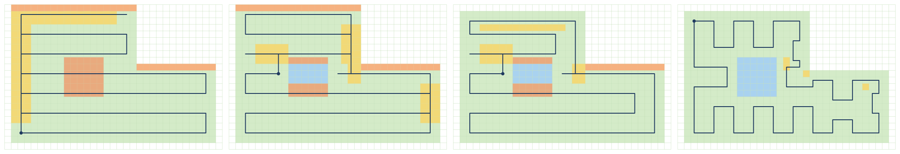

| approach                  | toy lawn, 1 cutter | toy lawn, 2 cutters |
| ------------------------- | ------------------ | ------------------- |
| plain lanes               | 212                |                     |
| lane segments, good order | 194                | 112                 |
| corner moves              | 180                | 110                 |
| ruin and recreate         | **160**            | **84**              |
| lower bound (cannot beat) | 156                | 78                  |

From 36% above the lower bound down to 2.6%. The orange and yellow waste shrinks
panel by panel.

On the 250 real lawns, the score over three weeks:

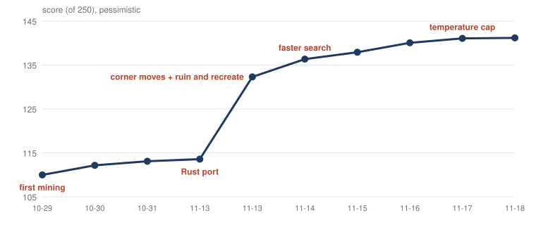

The big jump on 13 November is corner moves plus ruin and recreate, made
possible by the Rust rewrite. See [timeline.md](timeline.md) for every step.

---

## 15. Where we stand, and what is next

**Score: 141.18 of 250** (pessimistic), up from about 110. Every one of the 250
tours passes the official verifier.

**When to stop a kind of run.** Every pass of the same search on the same tours
pays less than the one before. We stop when a pass earns under 0.002 points per
CPU hour:

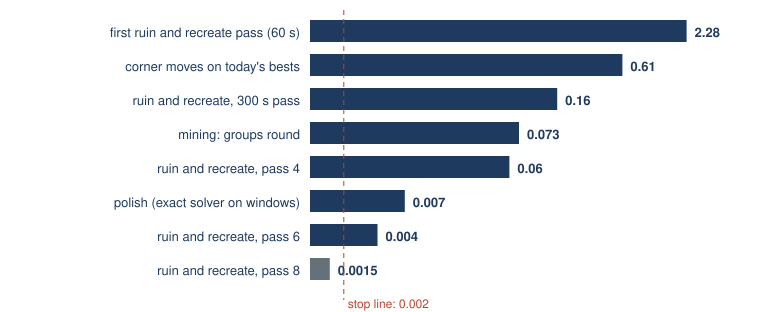

(The scale is **logarithmic**: each step to the left is ten times smaller.)

The eighth ruin-and-recreate pass fell under the line. Corner moves on today's
best tours still pay 0.61 points per CPU hour, 400 times more, so the next step
is to build corner moves into ruin and recreate itself.

**Lessons**

- Measure before building: a fixed test set, a waste breakdown, a gate.
- Speed only paid once a search could spend it.
- Scale a search to the size of one move, not the size of the whole tour.

---

## Glossary

| word                  | meaning                                                                                      |
| --------------------- | -------------------------------------------------------------------------------------------- |
| A/B test              | two versions run side by side under the same conditions; keep the winner                     |
| adaptive (search)     | it learns which of its moves work and uses those more                                        |
| baseline              | the simple result every new idea is compared with                                            |
| bench                 | our fixed set of 31 test lawns                                                               |
| CPU hour              | one processor core working for one hour                                                      |
| cutter                | the blade's shape, a small group of squares                                                  |
| gap                   | how far a tour is above the lower bound, in percent                                          |
| gate                  | the test an idea had to pass on the bench before running on all 250 lawns                    |
| heuristic             | a method that finds a very good answer quickly, without proof it is the best                 |
| hull bound            | a tighter lower bound we proved for cutters with gaps in them, like the X                    |
| iterated local search | local search with random shake-ups when it gets stuck                                        |
| lane, segment         | a straight row of mowing; a segment is a piece of a lane that stays on the lawn              |
| local search          | improve an answer by small changes until no small change helps                               |
| lower bound           | a length that no tour can beat                                                               |
| mining                | running many settings on every lawn and keeping the best tour                                |
| move                  | one small change to a tour                                                                   |
| NP-hard               | a class of problems with no known fast method for the best answer                            |
| official verifier     | the contest's own program that checks a tour                                                 |
| or-opt, 2-opt         | classic moves: move a piece elsewhere; run a stretch backwards                               |
| pessimistic score     | our score if someone reached every lower bound; the real score is higher                     |
| ruin and recreate     | tear a piece out of the tour, then rebuild it                                                |
| simulated annealing   | a search that sometimes accepts a worse answer, less and less often over time                |
| stamp                 | the squares under the cutter at one position                                                 |
| step                  | the cutter moving one square up, down, left or right; a tour's length is its number of steps |
| temperature           | in simulated annealing, how much worse a move may be and still be accepted                   |
| tour                  | a route that starts and ends at the same place                                               |
| TSP                   | travelling salesman problem: the shortest round trip through given places                    |
| valid (feasible)      | a tour that mows every square and follows the rules                                          |

---

## For developers: where things are in the code

The code is a Rust **workspace**: the shared types in the middle
(`crates/domain`), every step as a plugin (`crates/plugins`), everything that
touches files or Python as an adapter (`crates/adapters`), and the `mow` command
on top (`crates/app`).

| step                       | code                                                                                                    |
| -------------------------- | ------------------------------------------------------------------------------------------------------- |
| read a lawn                | [`mow-io`](../crates/adapters/io/src/instance.rs), [`problem.rs`](../crates/domain/core/src/problem.rs) |
| lower bounds               | [`bounds.rs`](../crates/domain/core/src/bounds.rs), [`hull.rs`](../crates/domain/core/src/hull.rs)      |
| lanes and segments         | [`mow-decompose`](../crates/plugins/decompose/src/lib.rs)                                               |
| ordering the segments      | [`mow-order`](../crates/plugins/order/src/lib.rs)                                                       |
| repair and corner cuts     | [`mow-improve`](../crates/plugins/improve/src/lib.rs)                                                   |
| sharing between cutters    | [`mow-assign`](../crates/plugins/assign/src/lib.rs)                                                     |
| coverage checks            | [`mow-coverage`](../crates/domain/coverage/src/full.rs)                                                 |
| official verifier          | [`mow-verify`](../crates/adapters/verify/src/lib.rs), [`verify.py`](../tools/verify/verify.py)          |
| one solve, start to finish | [`mow-pipeline`](../crates/app/pipeline/src/solve.rs)                                                   |
| mining                     | [`grid.rs`](../crates/app/cli/src/grid.rs), [`mine/`](../crates/app/cli/src/mine/mod.rs)                |
| corner moves               | [`mow-turns`](../crates/plugins/turns/src/lib.rs)                                                       |
| ruin and recreate          | [`mow-lns`](../crates/plugins/lns/src/lib.rs)                                                           |
| exact window solver        | [`mow-polish`](../crates/plugins/polish/src/lib.rs), [`cpsat.py`](../tools/cpsat/cpsat.py)              |
| pictures of tours          | [`mow-viz`](../crates/adapters/viz/src/lib.rs)                                                          |
| the menus                  | [`mow-tui`](../crates/app/tui/src/lib.rs)                                                               |

The commands:

| command                             | what it does                                                   |
| ----------------------------------- | -------------------------------------------------------------- |
| `mow`                               | the menus: score, lawns, runs, experiments, merging, comparing |
| `mow solve <lawn> <setting>`        | one setting on one lawn                                        |
| `mow mine`                          | many settings on every lawn, keeping the best                  |
| `mow turns`                         | corner moves on the stored bests                               |
| `mow lns`                           | ruin and recreate on the stored bests                          |
| `mow polish`                        | the exact window solver (slow; small lawns only)               |
| `mow compare A B`                   | two tours, or two folders of tours, checked and compared       |
| `mow report \| diagnose \| catalog` | the score, where the length goes, facts about every lawn       |
| `mow bench run \| pick \| score`    | the 31-lawn test set                                           |
| `mow help`                          | every option                                                   |

The pictures on this page are drawn by `tools/slides/figures.py` and
`tools/slides/explainer.py` from the tours in `docs/slides/toy/`.
